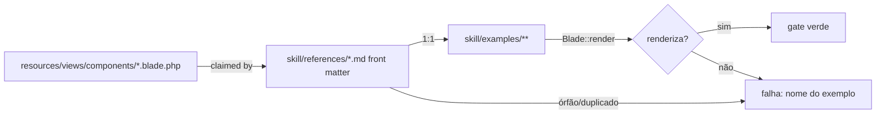

# 01 · Parte 1 — pasta `skill/`

## Layout alvo
```text
skill/
├── SKILL.md                      # movido de resources/boost/…/SKILL.md + índice com Primitives, Templates, Layouts
├── references/{name}.md          # 83 movidas + field.md, typography.md, icon.md (novas)
└── examples/
    ├── components/{reference}.blade.php   # 81 — 1 por reference de componente
    ├── templates/{name}.blade.php         # auth-login, auth-register, auth-magic-link, auth-reset-password, pricing
    ├── templates/{name}.livewire.blade.php# 4 variantes Livewire das auth
    └── layouts/{name}.blade.php           # classic, rail, topbar, split, centered, docs
```

## Requisitos
| ID | Requisito | Critério observável (1 execução decide) |
|---|---|---|
| REQ-S1 | `skill/` é a fonte; conteúdo da skill Boost é movido (`git mv`), não reescrito | `git log --follow skill/references/button.md` mostra histórico de `resources/boost/…/button.md` |
| REQ-S2 | Toda reference tem front matter `kind: component\|template\|layout\|guide`, `group:` e `components:` (lista de tags que ela documenta) | teste: parse YAML de 86 arquivos sem erro; `kind` ∈ enum |
| REQ-S3 | Todo `.blade.php` em `resources/views/components` (exceto `icons/`) é reivindicado por **exatamente uma** reference | teste: 211 arquivos → 211 claims, 0 órfãos, 0 duplicados; falha lista o nome |
| REQ-S4 | Toda reference `kind: component` tem `examples/components/{name}.blade.php`; `template`/`layout` têm seus arquivos em `examples/templates|layouts` | teste: 0 references sem exemplo; 0 exemplos sem reference |
| REQ-S5 | Todo exemplo renderiza com `Blade::render()` sem exceção, sem variável indefinida, em `en` | teste dataset sobre `skill/examples/**/*.blade.php` (96 casos) |
| REQ-S6 | Exemplos seguem as golden rules: só tokens (sem `bg-red-500`…), sem `dark:`, botão só-ícone com `aria-label` | lint test regex (tests/ui-design.md) |
| REQ-S7 | `SKILL.md` lista cada reference no índice por grupo, incl. novos grupos **Primitives**, **Layouts** | teste: todo `references/*.md` linkado 1× no SKILL.md |

## Formato de um exemplo (contrato)
- Primeira linha: `{{-- {Título}: {o que demonstra} — ver references/{name}.md --}}`.
- Autocontido: dados inline (`@php $rows = [...] @endphp`), nenhum `$this->…`, nenhuma rota nomeada (`href="#"`).
- Textos em inglês (padrão do kit); `wire:model`/`wire:click` permitidos (são atributos — renderizam sem componente Livewire).
- Variante `.livewire.blade.php` (só auth): `wire:submit` + `model="form"`; classe Livewire correspondente vem como comentário no topo.

## Front matter (contrato)
```yaml
---
kind: component          # component | template | layout | guide
group: Data              # Base | Overlay | Form | Navigation | Data | AI | Primitives | Templates | Layouts | Guides
components: [table, table.columns, table.column, table.rows, table.row, table.cell, table.empty, table.group, table.skeleton, pagination]
---
```
Aliases conhecidos (exemplo; T-003 confirma 211/211): `panel.md`→`card.*`; `data-table.md`→`table.*`; `choice.md`→`checkbox.*`,`radio.*`; `input-group.md`→`input.*`; `dropdown.md`→`menu.*`; `tabs.md`→`tabs`,`tab.*`; `chat-bubble.md`→`chat.*`; `command-palette.md`→`command.*`; `toast-group.md`→`toast.group`; `progress-toast.md`→`toast.progress`; `breadcrumb.md`→`breadcrumbs.*`. Novos: `field.md`→`field,label,error,description`; `typography.md`→`heading,text,eyebrow`; `icon.md`→`icon`; `layouts.md`→`layout.*,main,spacer,logo` (T-003 verifica uso real de `main/spacer/logo` antes de fixar).

## BDD (resumo — completo em acceptance/skill.feature)
```gherkin
Scenario: Success — every component has a rendered example
  Given the skill folder at "skill/"
  When the examples test renders every "skill/examples/**/*.blade.php"
  then 96 examples render without exception
Scenario: Error — a component file is not documented
  Given a new file "resources/views/components/foo.blade.php" claimed by no reference
  When the coverage test runs
  Then it fails naming "foo"
Scenario: Deviation — example uses a raw palette color
  Given "skill/examples/components/badge.blade.php" contains "bg-red-500"
  When the token lint runs
  Then it fails naming the file and the class
```


