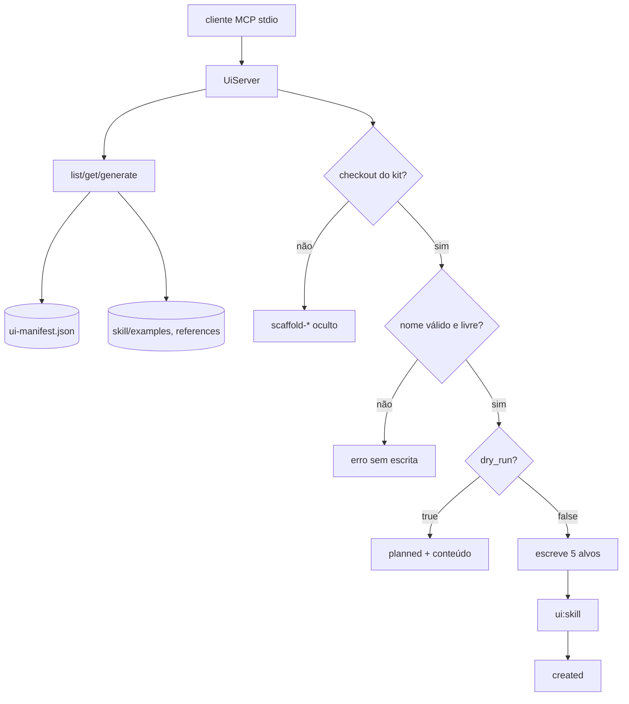

# 02 · Parte 2 — servidor MCP `devaction-ui`

## Execução (100% local, stdio)
- App consumidor: `composer require laravel/mcp` → `php artisan mcp:start devaction-ui`.
- Checkout do kit (autoria): `vendor/bin/testbench mcp:start devaction-ui` (providers via `testbench.yaml`, export-ignore).
- Config do cliente (README):
```json
{ "mcpServers": { "devaction-ui": { "command": "php", "args": ["artisan", "mcp:start", "devaction-ui"] } } }
```

## Tools
| Tool | Tipo | Registrada quando | Saída |
|---|---|---|---|
| `list-components` | consumo, read-only | sempre | JSON: `[{name, tag, kind, group, summary}]` |
| `get-component` | consumo, read-only | sempre | JSON: entrada do manifesto + `example` (conteúdo) + `reference` (markdown) |
| `generate-component` | consumo, read-only | sempre | texto: markup `<x-ui::…>` pronto |
| `generate-template` | consumo, read-only | sempre | texto: arquivo Blade da página (+ classe Livewire no modo livewire) |
| `scaffold-component` | autoria, escreve | só no checkout do kit | JSON: arquivos `created`/`planned` (+ conteúdo em dry-run) |
| `scaffold-template` | autoria, escreve | só no checkout do kit | idem |

## Requisitos
| ID | Requisito | Critério observável |
|---|---|---|
| REQ-M1 | Servidor registrado com `Mcp::local('devaction-ui', UiServer::class)` só se `class_exists(Laravel\Mcp\Facades\Mcp::class)`; sem laravel/mcp o pacote boota igual | teste: provider sem laravel/mcp não lança; com, `Registrar::getLocalServer('devaction-ui')` ≠ null |
| REQ-M2 | `list-components` filtra por `group` (enum) e `query` (substring sem acento/caixa em name+summary) | `group=Form` → só Form; `query=data` contém `table`; `group=Xyz` → erro de validação |
| REQ-M3 | `get-component {name}` aceita tag (`table.row`) ou nome da reference (`data-table`); devolve props, attributes, slots, children, exemplo, reference | `name=button` contém `"variant"` default `"outline"` e exemplo; `name=nope` → erro `Unknown component "nope". Did you mean: …` (até 3 sugestões por levenshtein) |
| REQ-M4 | `generate-component {name, props?, slot?, slots?}` monta markup: `true`→atributo nu, `false`/número→`:prop="…"`, string iniciada por `$`→`:prop="$x"`, demais→`prop="valor"` com chave kebab-case e valor escapado (`e()`) | ver tabela de casos em tests/business-rules.md |
| REQ-M5 | Chave desconhecida (não é prop, não é attribute documentado, não casa `^(wire:\|x-\|@\|aria-\|data-)` nem `class\|id\|style\|name\|value\|placeholder\|title\|href\|type`) → erro listando props válidas; nome de attribute fora de `^(?:[A-Za-z:][A-Za-z0-9:._-]*\|@[a-z][a-z0-9.-]*)$` → `Invalid attribute name "<key>".`; nome de slot fora de `^[a-z][a-z0-9]*(-[a-z0-9]+)*$` → `Invalid slot name "<name>".` (`MarkupBuilder.php:16,18,45-46,71-72`) | `props={"varient":"primary"}` → erro cita `variant`; `wire:x"onmouseover="alert(1)` → `Invalid attribute name`; slot `a><script>x</script><x-slot:b` → `Invalid slot name` |
| REQ-M6 | Markup gerado passa `Blade::compileString()` sem exceção; tool devolve erro se não compilar | teste com slot contendo `@if` sem `@endif` → erro |
| REQ-M7 | `generate-template {template, mode=post\|livewire, brand?}`: template ∈ 11 valores; `mode=livewire` só p/ `auth.*` (senão erro); `brand` troca todo valor de atributo `="Acme"` (marca-placeholder dos exemplos: `auth.layout brand=`, `sidebar.brand name=`) | `template=auth.login mode=livewire` devolve Blade com `wire:submit="login"` + classe `Login` com `email,password,remember` |
| REQ-M8 | Tools de autoria só registram (`shouldRegister`) quando raiz do pacote **não** está sob `/vendor/` **e** `tests/TestCase.php` existe (export-ignore ⇒ só no checkout) | teste com raiz falsa em `vendor/devaction/ui` → `tools/list` sem `scaffold-*` |
| REQ-M9 | `scaffold-*`: `name` casa `^[a-z][a-z0-9]*(-[a-z0-9]+)*(\.[a-z][a-z0-9]*(-[a-z0-9]+)*)?$`; recusa se qualquer arquivo alvo existir; `dry_run` default **true**; nunca escreve fora da raiz do pacote | `name=../x` → erro; existente → erro com caminho; dry-run → 0 arquivos novos (`git status` limpo) |
| REQ-M10 | Zero rede: nenhuma tool usa `Http`, sockets ou URL remota; tudo vem de arquivos do pacote | `Http::preventStrayRequests()` em toda a suíte MCP + grep estático = 0 |

## O que `scaffold-component {name, group, summary, props[], children[], dry_run}` cria
1. `resources/views/components/{path}.blade.php` — cabeçalho `{{-- --}}` (summary + exemplo + props) + `@props([...])` + root `<div {{ $attributes->class('…') }}>{{ $slot }}</div>`; `children` viram `{name}/index.blade.php` + `{name}/{child}.blade.php`.
2. `tests/Feature/{Studly}ComponentTest.php` — teste Pest no estilo de `SeparatorComponentTest` (`Blade::render('<x-ui::{name}>Hello</x-ui::{name}>')` contém `Hello`); kit não tem convenção `data-ui` (grep: só `data-layout`, `data-auth-form`…).
3. `skill/references/{name}.md` — front matter + seções `Examples`, `API`, `Accessibility` (TODO marcados).
4. `skill/examples/components/{name}.blade.php` — exemplo mínimo renderizável.
5. Linha no índice de `skill/SKILL.md` sob `### {group}`.
6. Roda `ui:skill` (manifesto + espelho Boost) e devolve a lista final.
`scaffold-template {name, kind=template|layout, summary, dry_run}`: mesmo fluxo tudo-ou-nada (`Scaffolder.php`); `next_steps` em `ScaffoldTool.php:49`.
- `layout` = 4 alvos: `resources/views/components/layout/{name}.blade.php`; teste `tests/Feature/{Studly}LayoutTest.php`; exemplo `skill/examples/layouts/{slug}.blade.php`; update de `skill/references/layouts.md` (`layout.{name}` na lista `components:` + seção `## {Title}` com TODO antes de "Layout pieces"). `next_steps` manda incluir o nome no mapa do `GenerateTemplateTool`.
- `template` = 5 alvos: `resources/views/components/{name}/index.blade.php` (filhos viram `{name}/{child}.blade.php`); teste `tests/Feature/{Studly}TemplateTest.php`; `skill/references/{slug}.md`; exemplo `skill/examples/templates/{slug}.blade.php`; update do índice `skill/SKILL.md`.

## BDD (completo em acceptance/mcp.feature)
```gherkin
Scenario: Success — generate a button
  When I call "generate-component" with name "button", props {"variant":"primary","icon":"add-01"} and slot "New deal"
  Then the text is '<x-ui::button variant="primary" icon="add-01">New deal</x-ui::button>'
Scenario: Error — unknown prop
  When I call "generate-component" with name "button" and props {"varient":"primary"}
  Then the response is an error mentioning "variant"
Scenario: Deviation — authoring tool inside a consumer app
  Given the package root is "vendor/devaction/ui"
  When I list the tools
  Then "scaffold-component" is not listed
```


