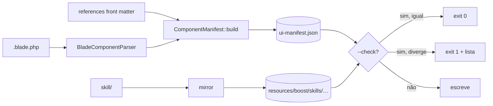

# 03 · Manifesto + comando `ui:skill` + espelho Boost

## Fluxo
`resources/views/components/**/*.blade.php` + `skill/references/*.md` (front matter) + `skill/examples/**` ⇒ **`ComponentManifest::build()`** ⇒ `resources/ui-manifest.json` ⇒ lido por MCP e testes. O mesmo comando copia `skill/` ⇒ `resources/boost/skills/devaction-ui-development/`.

## Requisitos
| ID | Requisito | Critério observável |
|---|---|---|
| REQ-F1 | Extrai de cada `.blade.php`: `name` (path com `/`→`.`, `index` removido), `tag` (`x-ui::{name}`), `file` relativo, `doc` (texto do 1º `{{-- --}}`), `props` (`[{name, default}]` do `@props([...])`, chave camelCase convertida p/ kebab em `attribute`), `attributes` (`$attributes->get('x')` / `->has('x')`), `slots` (`<x-slot:nome>` vistos no `doc` + `isset($nome)`/`$nome->isNotEmpty()`), `children` (arquivos irmãos na pasta) | teste unitário em fixtures + snapshot de `button`: props contém `variant=outline`, attributes contém `icon:trailing`, `tooltip:kbd` |
| REQ-F2 | `@props` é lido **sem executar PHP**: tokenizer (`token_get_all`) sobre o array; default não-literal (ex.: `__('x')`, `[]`) vira string crua (`"__('x')"`) | fixture com default `null`, `false`, `'base'`, `[]`, `__('Sign in')` → 5 valores corretos |
| REQ-F3 | Junta front matter: `kind`, `group`, `summary` (1º parágrafo da reference), `reference`, `example` (paths) | `table.row` → group `Data`, reference `skill/references/data-table.md` |
| REQ-F4 | Saída determinística: chaves ordenadas, componentes ordenados por `name`, JSON `JSON_PRETTY_PRINT\|JSON_UNESCAPED_SLASHES\|JSON_UNESCAPED_UNICODE` + `\n` final; sem data/sha | rodar 2× → bytes idênticos |
| REQ-F5 | `php artisan ui:skill` escreve manifesto + espelho; `--check` não escreve e sai 1 listando arquivos divergentes (manifesto, espelho faltando/sobrando/diferente) | ver tests/validation.md |
| REQ-F6 | Teste de drift na suíte: `ui:skill --check` exit 0 no repo commitado; `composer test` inclui `test:skill` | CI vermelho se alguém editar `.blade`/reference sem rodar `ui:skill` |

## Esquema do manifesto (JSON Schema, contrato)
```json
{
  "$schema": "https://json-schema.org/draft/2020-12/schema",
  "type": "object",
  "required": ["version", "components"],
  "properties": {
    "version": { "const": 1 },
    "components": {
      "type": "array",
      "items": {
        "type": "object",
        "required": ["name", "tag", "file", "kind", "group", "reference", "props", "attributes", "slots", "children"],
        "properties": {
          "name": { "type": "string", "pattern": "^[a-z][a-z0-9-]*(\\.[a-z][a-z0-9-]*)*$" },
          "tag": { "type": "string" },
          "file": { "type": "string" },
          "kind": { "enum": ["component", "template", "layout"] },
          "group": { "type": "string" },
          "summary": { "type": "string" },
          "doc": { "type": "string" },
          "reference": { "type": "string" },
          "example": { "type": ["string", "null"] },
          "props": { "type": "array", "items": { "type": "object", "required": ["name", "attribute"],
            "properties": { "name": {"type": "string"}, "attribute": {"type": "string"}, "default": {} } } },
          "attributes": { "type": "array", "items": { "type": "string" } },
          "slots": { "type": "array", "items": { "type": "string" } },
          "children": { "type": "array", "items": { "type": "string" } }
        }
      }
    }
  }
}
```
`example` = exemplo da reference dona (filhos herdam o do pai). Templates/layouts com mais de um exemplo listam o principal; `generate-template` resolve os demais pelo nome.

## BDD (completo em acceptance/manifest.feature)
```gherkin
Scenario: Success — manifest is in sync
  Given the committed "resources/ui-manifest.json"
  When I run "ui:skill --check"
  Then the exit code is 0
Scenario: Error — a blade prop changed without rebuilding
  Given "button.blade.php" gains the prop "pressed"
  When I run "ui:skill --check"
  Then the exit code is 1 and the output lists "resources/ui-manifest.json"
Scenario: Deviation — Boost mirror edited by hand
  Given "resources/boost/skills/devaction-ui-development/SKILL.md" differs from "skill/SKILL.md"
  When I run "ui:skill --check"
  Then the exit code is 1 and the output lists the mirror file
```


