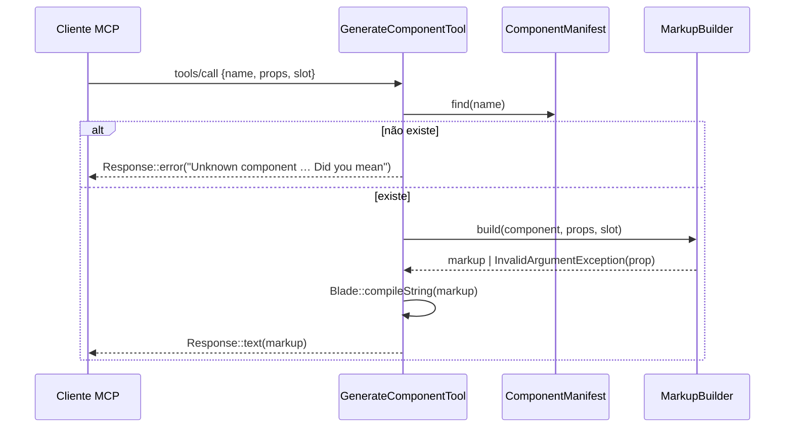

# 04 · Spec técnica

## Arquivos (novos `+`, alterados `~`, movidos `>`)
| Arquivo | Papel |
|---|---|
| `> resources/boost/skills/devaction-ui-development/** → skill/**` | fonte da skill (REQ-S1) |
| `+ skill/references/{field,typography,icon}.md`, `+ skill/examples/**` (96) | Parte 1 |
| `+ src/Support/BladeComponentParser.php` | lê 1 `.blade.php` → array (REQ-F1/F2), sem I/O além do arquivo recebido |
| `+ src/Support/ComponentManifest.php` | junta parser + front matter + exemplos; `build(): array`, `load(): self` (lê JSON 1×, memo estático), `find(string): ?array`, `search(?group, ?query)` |
| `+ src/Support/SkillMirror.php` | `diff(): list<string>`, `sync(): void` entre `skill/` e espelho Boost |
| `+ src/Console/SkillCommand.php` | `ui:skill {--check}` (REQ-F5) — mesmo estilo de `IconCommand` (`$this->components->…`) |
| `+ src/Mcp/UiServer.php` | `#[Name('DevAction UI')]`, `$tools` = 6 classes |
| `+ src/Mcp/Tools/{ListComponents,GetComponent,GenerateComponent,GenerateTemplate,ScaffoldComponent,ScaffoldTemplate}Tool.php` | uma tool por classe |
| `+ src/Mcp/Tools/ScaffoldTool.php` | base abstrata das tools de autoria; `shouldRegister()` = `Scaffolder::isKitCheckout()` |
| `+ src/Mcp/MarkupBuilder.php` | regra pura de REQ-M4/M5 (testável sem MCP) |
| `+ src/Mcp/Scaffolder.php` | plano de arquivos + escrita (REQ-M8/M9); `PackagePath::root()` = `dirname(__DIR__, 2)` |
| `~ src/UiServiceProvider.php` | registra `SkillCommand`; `Mcp::local(...)` se `class_exists(Mcp::class)` |
| `+ resources/ui-manifest.json` | gerado |
| `+ testbench.yaml` | providers `UiServiceProvider` + `Laravel\Mcp\Server\McpServiceProvider` p/ `vendor/bin/testbench mcp:start` |
| `~ composer.json` | `require-dev: laravel/mcp ^0.6`, `suggest: laravel/mcp`, script `test:skill` em `test` |
| `~ .gitattributes` | `testbench.yaml export-ignore`; `skill/` **não** é ignorado (MCP lê exemplos no app) |
| `~ README.md`, `~ resources/boost/guidelines/core.blade.php` | seções "Skill" e "MCP server" |
| `+ AGENTS.md`, `+ docs/adr/001-skill-mcp.md` | contexto para agentes; ADR da skill + MCP |
| `+ tests/Feature/Mcp/{ToolContractTest,ScaffolderEdgeCasesTest,StdioE2ETest,NoNetworkTest,TemplateMapTest}.php`, `+ tests/Unit/SupportEdgeCasesTest.php` | contrato das tools, edge cases do scaffolder, E2E stdio, zero rede (REQ-M10), mapa de templates, edge cases de Support |
| `~ .github/workflows/tests.yml` | step `Skill` = `composer test:skill` (`ui:skill --check`) |
| `~ resources/views/components/pagination.blade.php`, `~ lang/pt_BR.json` | chave `Pagination navigation` → `Paginação` |
| `~ src/Console/IconCommand.php` | checagem `is_array` removida (parse do módulo via regex, `IconCommand.php:146-153`) |

## UML (classes)
```mermaid
classDiagram
  class BladeComponentParser { +parse(string path, string root) array }
  class ComponentManifest { +build() array +load() self +find(string) ?array +search(?string group, ?string query) list +examplePath(string) ?string }
  class SkillMirror { +diff() list~string~ +sync() void }
  class SkillCommand { +handle(ComponentManifest, SkillMirror) int }
  class MarkupBuilder { +build(array component, array props, ?string slot, array slots) string }
  class Scaffolder { +plan(string kind, array input) list~PlannedFile~ +write(list) void +isKitCheckout() bool }
  class UiServer
  class Tool
  UiServer --> Tool : 6 tools
  Tool <|-- ListComponentsTool
  Tool <|-- GetComponentTool
  Tool <|-- GenerateComponentTool
  Tool <|-- GenerateTemplateTool
  Tool <|-- ScaffoldComponentTool
  Tool <|-- ScaffoldTemplateTool
  ComponentManifest --> BladeComponentParser
  SkillCommand --> ComponentManifest
  SkillCommand --> SkillMirror
  GenerateComponentTool --> MarkupBuilder
  ScaffoldComponentTool --> Scaffolder
  Scaffolder --> SkillCommand : chama ui:skill
```

## Sequência (generate-component)


## Contratos de entrada (JSON Schema via `schema(JsonSchema $s)`)
| Tool | Campos |
|---|---|
| list-components | `group?: enum(Base,Overlay,Form,Navigation,Data,AI,Primitives,Templates,Layouts)`, `query?: string` |
| get-component | `name: string` (required) |
| generate-component | `name: string` (req, max 100), `props?: object<string,string\|number\|boolean>` (≤50 entradas; string ≤2000 chars), `slot?: string` (≤20000), `slots?: object<string,string>` (≤20 entradas; cada valor ≤20000). `$`-valores = expressão PHP ligada; slot/slots = Blade cru confiável (`GenerateComponentTool.php:22,30-45`) |
| generate-template | `template: enum(auth.login,auth.register,auth.magic-link,auth.reset-password,pricing,layout.classic,layout.rail,layout.topbar,layout.split,layout.centered,layout.docs)` (req), `mode?: enum(post,livewire)=post`, `brand?: string` |
| scaffold-component | `name` (req, regex REQ-M9), `group: enum` (req), `summary: string` (req), `props?: [{name, default?}]`, `children?: string[]`, `dry_run?: bool=true` |
| scaffold-template | `name` (req), `kind: enum(template,layout)` (req), `summary` (req), `dry_run?: bool=true` |
Validação via `$request->validate([...])` (laravel/mcp devolve erro MCP com as mensagens). Annotations (`Laravel\Mcp\Server\Tools\Annotations`): consumo `#[IsReadOnly]` + `#[IsIdempotent]`; autoria sem annotation (cria arquivos, nunca apaga nem sobrescreve). Assinatura dos atributos conferida em T-008 antes de usar.

## Compat {#compat}
- Nenhuma tag, prop, slot ou view existente muda; `resources/boost/…` mantém mesmo conteúdo (espelho) ⇒ apps com Boost não percebem.
- laravel/mcp é **opcional** (suggest): app sem ele não carrega `src/Mcp` (classes só referenciadas dentro do `if class_exists`). PHPStan: `src/Mcp` analisado com laravel/mcp em require-dev.
- laravel/mcp ^0.6 exige illuminate ≥12.41.1; pacote aceita ^12.0 — só afeta quem instala o MCP (documentar).
- Versão: minor (`0.4.0`), não breaking.

## Engineering baseline
KISS (tools finas, regra em `MarkupBuilder`/`Scaffolder`) · YAGNI (sem resources/prompts MCP, sem cache em disco) · reuse (`IconCommand` como padrão de comando, `Blade::compileString` p/ validação, `laravel/mcp` validate) · SOLID (parser ≠ manifesto ≠ tool) · framework-native (Artisan, Testbench, laravel/mcp) · regra isolada do transporte (MarkupBuilder/Scaffolder não conhecem MCP).
