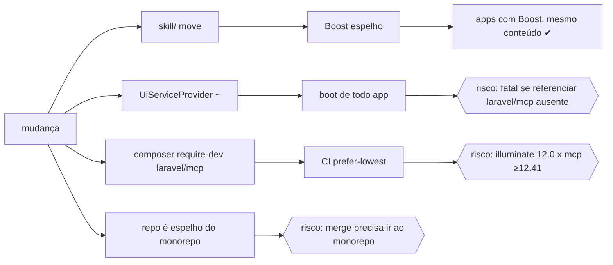

# 05 · Research gate, impacto, gaps, ADR

## Research Completeness Gate
| Item | Evidência |
|---|---|
| Cadeia de dependência (5 níveis) | app → `devaction/ui` → `UiServiceProvider` → (`SkillCommand`, `Mcp::local`) → `UiServer` → tools → `ComponentManifest` → `ui-manifest.json` + `skill/`; `laravel/mcp` → `illuminate/json-schema ^12.41.1` (composer.json de laravel/mcp v0.6.5) |
| Enums/transições | `kind`: component/template/layout/guide; `group`: 10 valores (spec/01); `mode`: post/livewire; scaffold: `planned → created` (só com `dry_run=false`), nunca `created → overwritten` |
| Casos de uso | UC1 dev do app pergunta "quais componentes de form?" · UC2 pede markup pronto · UC3 pede tela de login Livewire · UC4 mantenedor cria componente novo · UC5 CI detecta drift |
| Reuse-before-create | skill Boost movida (83 refs); cabeçalhos `{{-- --}}` dos 211 blades; `IconCommand` como modelo de comando/teste; `Blade::compileString`; `laravel/mcp` (`Request::validate`, `Response::error/json/text`, `Server::tool()` p/ teste) |
| Anti-N+1 | sem DB; equivalente: manifesto lido 1× por processo (memo), nunca parse de 211 blades por chamada |
| Contratos externos | MCP 2025 via laravel/mcp (stdio, `StdioTransport`); Boost lê `resources/boost/skills` (`Support/Composer::packagesDirectoriesWithBoostSkills`) |

## Edge cases (≥5)
1. Blade sem `@props` (28 arquivos: 211 − 183) → `props: []`, não erro.
2. Default não-literal (`__('Sign in')`, `[]`, closures) → string crua (REQ-F2).
3. Nome com ponto (`table.row`) vs reference (`data-table`) em `get-component` → ambos resolvem.
4. `generate-component` com valor contendo `"` ou `{{` → escapado por `e()`; slot é inserido cru (é Blade do usuário) mas compilado p/ validar.
5. `scaffold-component name=button` (existente) → erro, 0 escrita; `name=Foo`/`../x`/`a..b` → erro de regex.
6. App sem laravel/mcp → provider não referencia `Laravel\Mcp\*` (autoload não dispara).
7. Pacote instalado via path repository/symlink (`composer` `"type":"path"`) → raiz real não está em `/vendor/` mas `tests/TestCase.php` existe ⇒ autoria **habilitada** (desejado: dev local do kit).
8. `icons/` (376 arquivos) fora do manifesto (são SVG parciais, não componentes).

## Impact flow — `RISKS_FOUND`

| Risco | Mitigação | Teste |
|---|---|---|
| R1 fatal no boot sem laravel/mcp | `class_exists` antes; nenhum `use Laravel\Mcp` no provider (FQCN em string) | integration: boot com `class_exists` falso (provider isolado) |
| R2 prefer-lowest | composer resolve illuminate ≥12.41 quando mcp está em require-dev; CI já roda Laravel 13 (testbench ^11) | CI matrix existente |
| R3 espelho | ver Unresolved U1 | — |

## Gap table (PRD × spec)
| Pedido do usuário | Coberto por | Gap |
|---|---|---|
| "pasta skill" | spec/01 | — |
| "exemplo de cada template" | 9 templates + 6 layouts (REQ-S4) | — |
| "exemplo de cada componente" | 81 exemplos, 211/211 blades reivindicados (REQ-S3) | — |
| "via MCP como criar cada componente" | generate-component + scaffold-component | — |
| "e cada template" | generate-template + scaffold-template | — |
| "100% local" | stdio, REQ-M10, sem rede | — |

## ADR triage
**ADR-001 (necessário)** — *Skill-fonte em `skill/` + manifesto gerado + MCP em PHP opcional.* Contexto: Boost só lê `resources/boost/skills`; usuário quer skill e MCP separados mas coerentes. Decisão: D1–D4 (spec.md). Consequências: +1 comando a rodar ao mudar componente (forçado por teste de drift); dependência 0.x opcional. Alternativas rejeitadas: symlink (quebra em Windows/zip dist), Node MCP (segundo stack), parse de md em runtime (frágil). Registrar em `docs/adr/001-skill-mcp.md` durante T-012.

## Swept (9 dimensões)
| Dim | Resultado |
|---|---|
| Dados/DB | N/A — sem banco |
| Segurança | escrita restrita à raiz do pacote, regex de nome, sem overwrite, dry-run default, autoria oculta em `vendor/`, sem rede |
| Performance | manifesto memoizado; ~100 KB JSON estimado (verificar em T-004) |
| Acessibilidade | lint exige `aria-label` em botão só-ícone nos exemplos |
| i18n | exemplos em inglês; renderizados com locale `en` |
| Compat | spec/04#compat |
| Observabilidade | `ui:skill --check` lista divergências; erros MCP com mensagem acionável |
| Docs | README + guideline Boost |
| Testes | tests.md (9 tipos) |

## Unresolved
| ID | Item | Tipo |
|---|---|---|
| U1 | README diz que este repo é espelho read-only do monorepo (`packages/devaction-ui`). Implementar aqui e portar, ou implementar no monorepo? | `blocks go-live` |
| U2 | laravel/mcp é 0.x: pin `^0.6` pode quebrar em `0.7`. Aceitar e revisar a cada minor? | `open` |
| U3 | Baseline de testes não medida (sem `vendor/`, PHP 8.3 local) — T-001 resolve | `blocks` (T-002+) |
