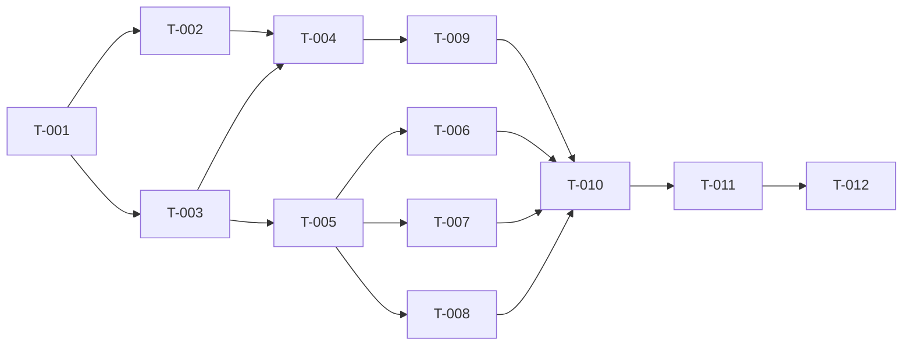

# Tasks — ui-skill-mcp

TDD em toda task de código: teste RED primeiro, depois GREEN. Rodar Pint/PHPStan só nos arquivos alterados. Nunca commitar (decisão do usuário).

| ID | Task | depends_on | REQs | Laya flags |
|---|---|---|---|---|
| [T-001](T-001-baseline.md) | Ambiente PHP 8.5 + baseline `composer test` | — | U3 | — |
| [T-002](T-002-blade-parser.md) | `BladeComponentParser` | T-001 | F1, F2 | — |
| [T-003](T-003-skill-move.md) | Mover skill p/ `skill/`, front matter, 3 refs novas, índice | T-001 | S1, S2, S3, S7 | breaking? não (espelho igual) |
| [T-004](T-004-manifest-command.md) | `ComponentManifest`, `SkillMirror`, `ui:skill`, drift test | T-002, T-003 | F3–F6 | — |
| [T-005](T-005-examples-base-overlay.md) | 35 exemplos Base+Overlay + testes render/lint | T-003 | S4, S5, S6 | — |
| [T-006](T-006-examples-form-navigation.md) | 29 exemplos Form+Navigation | T-005 | S4–S6 | — |
| [T-007](T-007-examples-data-ai-primitives.md) | 17 exemplos Data+AI+Primitives | T-005 | S4–S6 | — |
| [T-008](T-008-templates-layouts.md) | 9 exemplos de template + 6 de layout | T-005 | S4–S6 | — |
| [T-009](T-009-mcp-server-read.md) | `UiServer`, registro opcional, `list-components`, `get-component` | T-004 | M1–M3, M10 | security: sinalizar |
| [T-010](T-010-mcp-generate.md) | `MarkupBuilder`, `generate-component`, `generate-template` | T-009, T-006, T-007, T-008 | M4–M7 | — |
| [T-011](T-011-mcp-scaffold.md) | `Scaffolder`, `scaffold-component`, `scaffold-template` | T-010 | M8, M9 | security: **sim** (escreve arquivo) |
| [T-012](T-012-docs-ci.md) | README, guideline Boost, ADR-001, `test:skill`, e2e stdio | T-011 | F6, todos | — |

## Rastreabilidade REQ → TASK → TEST
| REQ | Task | Testes (tests/…) |
|---|---|---|
| S1 | T-003 | integration#I1 |
| S2, S3, S7 | T-003 | validation#V1–V3 |
| S4, S5 | T-005..T-008 | integration#I2, ui-design#D1 |
| S6 | T-005..T-008 | ui-design#D2–D3 |
| F1, F2 | T-002 | unit#U1–U6 |
| F3, F4 | T-004 | unit#U7–U9 |
| F5, F6 | T-004, T-012 | validation#V4–V6, e2e-regression#R1 |
| M1 | T-009 | integration#I3–I4 |
| M2, M3 | T-009 | integration#I5–I7 |
| M4, M5, M6 | T-010 | business-rules#B1–B10 |
| M7 | T-010 | business-rules#B11–B13 |
| M8, M9 | T-011 | security#S1–S7 |
| M10 | T-009 | security#S8–S9 |
| todos (fluxo real) | T-012 | e2e-flow#E1–E4 |
Cobertura 100% REQ→TASK→TEST (23/23: S1–S7, F1–F6, M1–M10).
