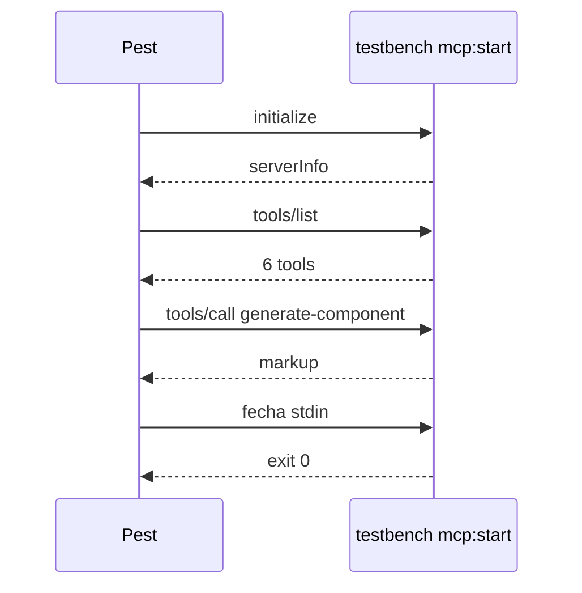

# E2E flow (stdio real, sem mocks)

Processo: `proc_open([PHP_BINARY, 'vendor/bin/testbench', 'mcp:start', 'devaction-ui'])`. Timeout 10 s por mensagem. Sem rede.

| ID | Passos | Esperado |
|---|---|---|
| E1 | `initialize` → `notifications/initialized` | `result.serverInfo.name` = `DevAction UI` |
| E2 | `tools/list` (no checkout do kit) | 6 tools: list-components, get-component, generate-component, generate-template, scaffold-component, scaffold-template |
| E3 | `tools/call generate-component {"name":"button","props":{"variant":"primary"},"slot":"Save"}` | texto `<x-ui::button variant="primary">Save</x-ui::button>` |
| E4 | `tools/call scaffold-component {"name":"e2e-probe","group":"Base","summary":"Probe"}` (dry_run omitido) | `planned` com 5 caminhos; `git status --porcelain` inalterado |

